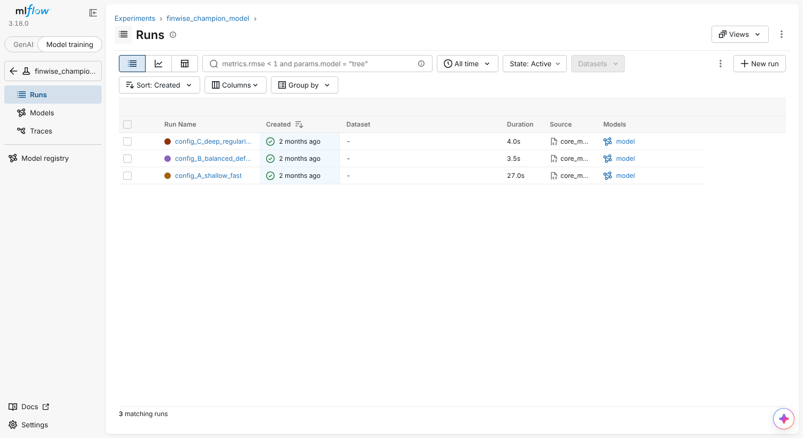
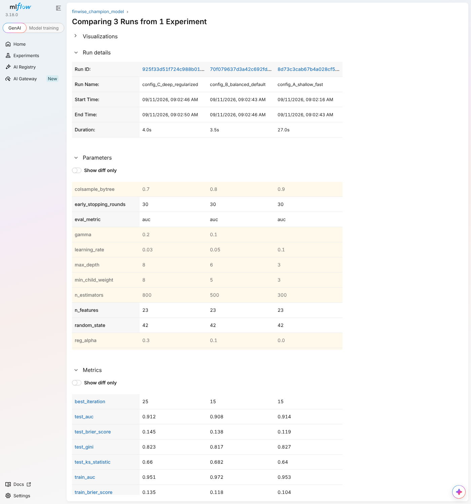
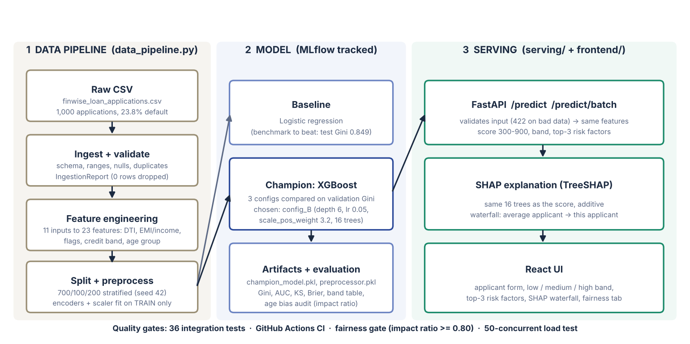

[](https://github.com/VedaShivayogi/finwise-full-project/actions/workflows/ci.yml)

# FinWise: Explainable Credit Risk Scoring

An end-to-end credit-risk system for a Bangalore FinTech client: an **XGBoost** model that scores loan applicants, **SHAP** explanations for every score
(top 3 risk factors + waterfall chart), a **FastAPI** REST service and a **React** UI.
Built by **Veda Shivayogi Ramagaondanahalli**, AI Intern, **Cynaris Solutions**.

| Result | Value |
|---|---|
| Test Gini (target 0.45 or higher) | **0.817** |
| Bands (actual default rate, test set) | low 0% / medium 12.5% / high 66% |
| Age bias audit, lowest impact ratio | 0.90 (gender not auditable: no gender column) |
| Integration tests | 41 passing, run by GitHub Actions on every push |
| Load test, 50 concurrent requests | 0 errors, about 366 req/s, p95 under 230 ms (1 shared CPU core) |

## Experiment tracking (MLflow) and best configuration
Three XGBoost hyperparameter configurations were trained and **logged to MLflow** (experiment `finwise_champion_model`, store `mlflow.db`): parameters, train/validation/test metrics, best iteration and the model.
**Best: `config_B_balanced_default`** (run `70f079637d3a42c692fd99f3a940c712`), chosen by highest validation Gini (0.875); test Gini 0.817 (target 0.45). Full evidence, including a 5-fold CV check showing the three
configurations are statistically tied, is in [`experiment_report.md`](experiment_report.md); every run is exported to [`reports/mlflow_runs.csv`](reports/mlflow_runs.csv).




```bash
python core_model_experimentation.py              # (re)train and log the 3 configs
mlflow ui --backend-store-uri sqlite:///mlflow.db # browse runs at http://127.0.0.1:5000 (run from the repo root)
python scripts/cv_check.py && python scripts/mlflow_report.py   # regenerate evidence (needs: pip install mlflow)
```
Note: run metadata (parameters, metrics) lives in `mlflow.db`. Stored model-artifact paths point to the folder where training originally ran, so the UI's *Artifacts* tab may be empty on another machine; the trained model itself is `artifacts/champion_model.pkl`.

## Documentation (start here)
| Document | What it covers |
|---|---|
| [`docs/LITERATURE_REVIEW.md`](docs/LITERATURE_REVIEW.md) | **Week 1:** review of 7 papers and 4 repositories and the design decisions they drove |
| [`docs/ARCHITECTURE.md`](docs/ARCHITECTURE.md) | **Week 1:** architecture diagram, data pipeline scaffold, model architecture, evaluation metrics |
| [`MODEL_CARD.md`](MODEL_CARD.md) | Data, metrics, limitations, bias audit, deployment guide |
| [`docs/WEEK4_SERVING_AND_LOAD_TEST_REPORT.md`](docs/WEEK4_SERVING_AND_LOAD_TEST_REPORT.md) | Latency and throughput results |
| [`experiment_report.md`](experiment_report.md) | MLflow experiment comparison (3 configurations) |
| [`docs/DEMO_SCRIPT.md`](docs/DEMO_SCRIPT.md) | 5-minute demo script |

## Architecture


## Repository structure
```
.
├── data_pipeline.py                 # DATA PIPELINE: ingest, validate, features, split, preprocessor
├── baseline_model.py                # Baseline: logistic regression
├── core_model_experimentation.py    # XGBoost experiments (3 configs) logged to MLflow
├── Checkpoint3_Core_Model_Experimentation.ipynb
├── finwise_loan_applications.csv    # training data (1,000 applications)
├── artifacts/                       # champion_model.pkl, preprocessor.pkl, metrics + metadata JSON
├── mlruns/, mlflow.db               # MLflow experiment tracking
├── serving/                         # FastAPI app: validation, scoring, SHAP, bands
├── frontend/                        # React UI (pre-built copy in frontend/dist)
├── tests/                           # 41 integration tests
├── loadtest/                        # load-test tool + report generator
├── scripts/bias_audit.py            # age bias audit -> reports/bias_audit.json
├── docs/                            # literature review, architecture, reports, demo script
├── MODEL_CARD.md
├── .github/workflows/ci.yml         # CI: tests + fairness gate + frontend build
├── requirements-serving.txt, requirements-dev.txt, Dockerfile, run.bat
└── README.md
```

## Data pipeline
`data_pipeline.py` is the single source of truth for turning raw applications into model features, shared by training and serving (no train/serve skew):
`load_raw_data` -> `validate_schema` -> `clean_and_validate_rows` -> `engineer_features` -> `split_data` (700/100/200, seed 42) -> `FinWisePreprocessor` (fit on train only).
Stage-by-stage table: [`docs/ARCHITECTURE.md`](docs/ARCHITECTURE.md#3-data-pipeline-scaffold-data_pipelinepy). Run just the pipeline:
```bash
python -c "import data_pipeline as dp; r = dp.run_pipeline('finwise_loan_applications.csv', artifacts_dir='artifacts_tmp'); print({k: v.shape for k, v in r.items() if hasattr(v, 'shape')})"
```

## Quick start (Python 3.10)
```bash
python -m pip install -r requirements-dev.txt
python -m pytest -q                               # expect 41 passed
python -m uvicorn serving.app:app --port 8000     # UI + API at http://localhost:8000  (API docs: /docs)
```
Windows: see [`QUICKSTART_WINDOWS.md`](QUICKSTART_WINDOWS.md) or double-click `run.bat`.
Example request:
```bash
curl -s localhost:8000/predict -H "content-type: application/json" -d '{"age":35,"income_annual_inr":300000,"employment_type":"contract","employment_years":5,"existing_loans":3,"existing_emi_inr":40000,"credit_score":560,"loan_amount_inr":2500000,"loan_purpose":"personal","ltv_ratio":0.9}'
```

## API
| Endpoint | Purpose |
|---|---|
| `POST /predict` | One application: score (300-900), band, top-3 risk factors, SHAP waterfall |
| `POST /predict/batch` | 1-500 applications |
| `GET /model-info` | Version, hyperparameters, metrics, bias audit |
| `GET /health` | 200 once the model is loaded |

## Project timeline
| Week | Milestone | Where to find it |
|---|---|---|
| 1 | Research + architecture design, repo and pipeline skeleton | `docs/LITERATURE_REVIEW.md`, `docs/ARCHITECTURE.md`, `data_pipeline.py`, this README |
| 2 | Ingestion/preprocessing pipeline, baseline model and report | `data_pipeline.py`, `baseline_model.py`, `baseline_*.png`, `artifacts/evaluation_benchmark.json` |
| 3 / 6 | Primary model, 3 configs, MLflow, best config with evidence | `core_model_experimentation.py`, `mlflow.db`, `experiment_report.md`, `reports/mlflow_runs.csv`, `docs/mlflow_ui_*.png` |
| 4 | Serving layer, integration tests, load test | `serving/`, `tests/`, `loadtest/`, `docs/WEEK4_...md` |
| 5 | Final demo, model card, CI | `MODEL_CARD.md`, `.github/workflows/ci.yml`, `docs/DEMO_SCRIPT.md` |

Earlier checkpoint notes are kept in [`docs/README_checkpoint_notes.md`](docs/README_checkpoint_notes.md).
