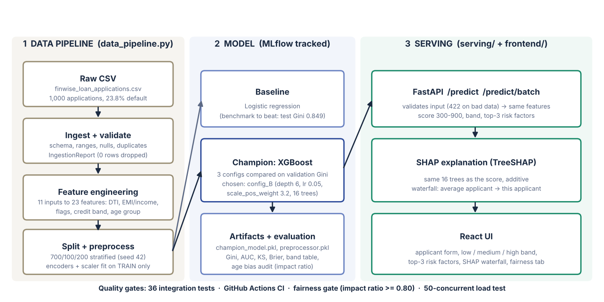
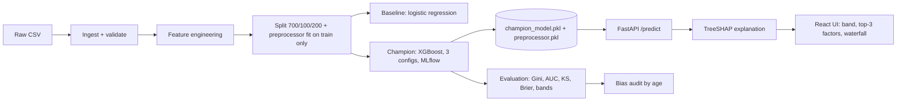
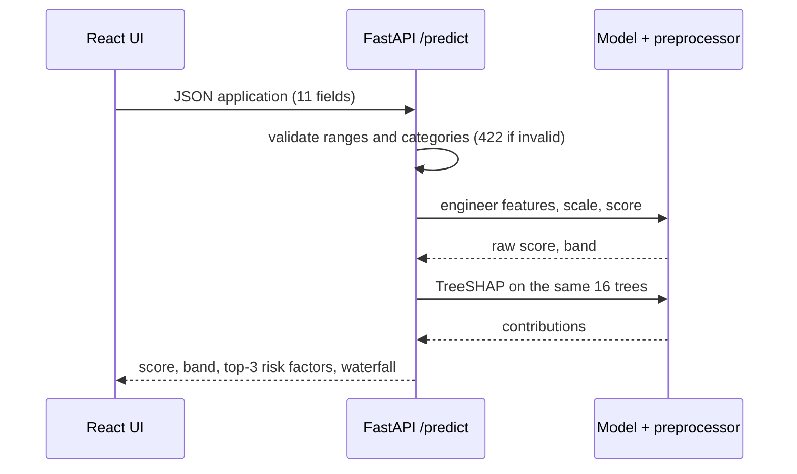

# Architecture and design: FinWise Credit Risk Scorer

## 1. Goal and acceptance criteria (from the client brief)
Build a credit-risk scoring system with explanations: train XGBoost on loan applications, explain each prediction with SHAP, serve it through a REST API, and show the score with the top 3 risk
factors in a React UI.

| Criterion | How it is measured | Status |
|---|---|---|
| Gini coefficient of 0.45 or higher on test set | `2*AUC - 1` on a held-out 200-row test set | 0.817 |
| SHAP waterfall chart per prediction | Returned by `/predict`, drawn in the UI; test checks it ends at the score | Done |
| UI shows low / medium / high band | React UI + band table | Done |
| API handles 50 concurrent requests | Load test, 0 errors | Done |
| Bias audit across gender and age | `scripts/bias_audit.py`, `reports/bias_audit.json` | Age done; gender not possible (no gender column) |

## 2. System overview (components)

| Component | Location | Responsibility |
|---|---|---|
| Data pipeline | `data_pipeline.py` | Ingestion, validation, feature engineering, split, preprocessor |
| Baseline model | `baseline_model.py`, notebook | Logistic regression benchmark |
| Experimentation | `core_model_experimentation.py`, notebook, `mlruns/` | 3 XGBoost configs, MLflow logging, champion selection |
| Artifacts | `artifacts/` | Pickled model + preprocessor, metadata JSON, benchmark JSON |
| Serving | `serving/` | FastAPI app, request validation, scoring, SHAP, risk bands |
| UI | `frontend/` | React app (applicant form, score band, factors, waterfall, fairness tab) |
| Quality | `tests/`, `.github/workflows/ci.yml`, `loadtest/` | Integration tests, CI, load tests |
| Documentation | `README.md`, `MODEL_CARD.md`, `docs/` | Model card, review, architecture, reports |

## 3. Data pipeline scaffold (`data_pipeline.py`)
Single source of truth for turning raw applications into model features. The same code is used by training, the baseline, the champion and the serving layer, so there is no train/serve skew.

| Stage | Function / class | Output |
|---|---|---|
| 1. Load | `load_raw_data(path)` | Raw dataframe |
| 2. Schema check | `validate_schema(df, report)` | Fails fast if columns are missing |
| 3. Row validation | `clean_and_validate_rows(df, report)` | Drops invalid rows; counts recorded in `IngestionReport` |
| 4. Ingest (1-3 combined) | `ingest(path)` | Clean dataframe + `IngestionReport` (saved by `run_pipeline` as `artifacts/ingestion_report.json`) |
| 5. Feature engineering | `engineer_features(df)` | 11 raw inputs become 23 model features (ratios, flags, bands) |
| 6. Split | `split_data(df)` | Stratified 700 train / 100 validation / 200 test, seed 42 |
| 7. Preprocess | `FinWisePreprocessor.fit / transform / save / load` | Encoders and scaler **fit on train only**, saved to `artifacts/preprocessor.pkl` |
| 8. Run all | `run_pipeline(csv_path, artifacts_dir)` | Splits + matrices + saved preprocessor |

Design rules: deterministic (fixed seed), no leakage (fit on train only), auditable (every step logs row counts), reusable (one preprocessor object used everywhere).

## 4. Model architecture
| Item | Choice | Reason |
|---|---|---|
| Baseline | Logistic regression on the same features | Industry-standard scorecard method; gives a benchmark to beat (literature review, source 1) |
| Primary model | XGBoost classifier (gradient-boosted trees) | Strong on small tabular data (sources 2 and 5); handles non-linearity and interactions; supports exact TreeSHAP (source 4) |
| Champion hyperparameters | `max_depth 6, learning_rate 0.05, subsample 0.8, colsample_bytree 0.8, min_child_weight 5, gamma 0.1, reg_alpha 0.1, reg_lambda 1.0, scale_pos_weight 3.2`, early stopping on validation AUC (best iteration 15, 16 trees) | Regularised to limit overfitting; class weight for 23.8% default rate |
| Experiment tracking | MLflow: 3 configurations (A shallow fast, B balanced default, C deep regularised) | Reproducible comparison; run id is the model version |
| Selection rule | Highest **validation** Gini; test set untouched until the end | Avoids selecting on the test set |
| Explanation | SHAP TreeExplainer values from the same 16 trees; waterfall in log-odds | Additive, exact for trees (sources 3 and 4) |
| Score and bands | Score = 300 + 600 x (1 - p). Low below 0.25, medium 0.25-0.50, high 0.50 or above | Cut-offs chosen on validation data |

## 5. Evaluation metrics (definitions and targets)
| Metric | Definition | Why | Target / result |
|---|---|---|---|
| **Gini** | `2 x AUC - 1` | Standard credit-scoring ranking metric; the client's acceptance metric | >= 0.45 required; test **0.817** |
| AUC | Probability a random defaulter scores higher than a random non-defaulter | Basis of Gini | test 0.908 |
| KS statistic | Maximum gap between cumulative score distributions of defaulters and non-defaulters | Common in credit risk; shows best separation point | test 0.682 |
| Brier score | Mean squared error of the predicted probability (lower is better) | Probability quality | test 0.138 |
| Band default rates | Actual default rate within low / medium / high | Shows whether the bands mean something | 0.0% / 12.5% / 66.1% |
| Impact ratio (fairness) | Group approval-side rate divided by best group's rate | Four-fifths rule | >= 0.80 required; lowest age 0.90 |
| Defaulters caught per group | True-positive rate of the High flag per group | Equality of opportunity (source 6) | Reported per age group |
| Latency / throughput | p50, p95, p99 and requests per second at 50 concurrent users | Serving requirement | 0 errors, about 366 req/s, p95 under 230 ms (1 shared core) |

**Evaluation protocol.** Stratified split (700/100/200); all fitted transforms on train only; model chosen on validation Gini; test metrics reported once; bias audit on the test split; every
number reproducible through the test suite (an end-to-end test re-scores the test rows through the API and checks the Gini).

## 6. Serving architecture (request flow)

- The model and preprocessor load once at start-up and are shared read-only; `/health` returns 200 only after loading and warm-up.
- A fast NumPy scoring path (default) is provably identical to the original pandas pipeline (tests on all 1,000 rows) and about 9 times cheaper per request.
- Scale out with one worker process per CPU core.

## 7. Key design decisions and trade-offs
| Decision | Alternative | Why this choice |
|---|---|---|
| XGBoost | Neural network, logistic regression only | Best fit for 1,000-row tabular data; native TreeSHAP; baseline kept for comparison |
| SHAP on same trees as the score | Default (all stored trees) | Saved model has 46 trees but early stopping chose 16; using all 46 changes scores by up to 0.20 |
| Bands instead of raw probability | Show probability | Class-weighted training makes raw scores uncalibrated |
| Pipeline shared by training and serving | Re-implement in the API | Eliminates train/serve skew; checked by parity tests |
| Audit by age only | Also gender | No gender column in the data; stated openly instead of guessing |

## 8. Risks and open items
Synthetic-looking small data; uncalibrated scores; age is a model input; gender not auditable; no authentication or monitoring yet. Details and mitigations: `MODEL_CARD.md`, sections 6-8.
