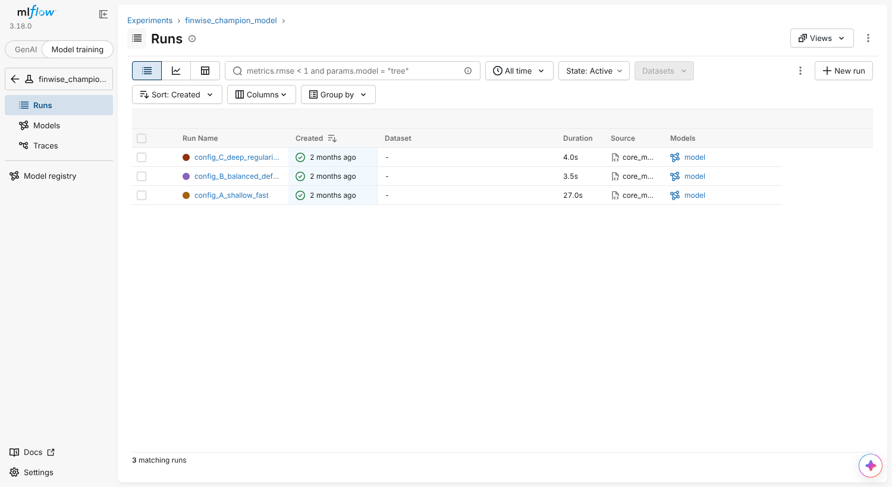
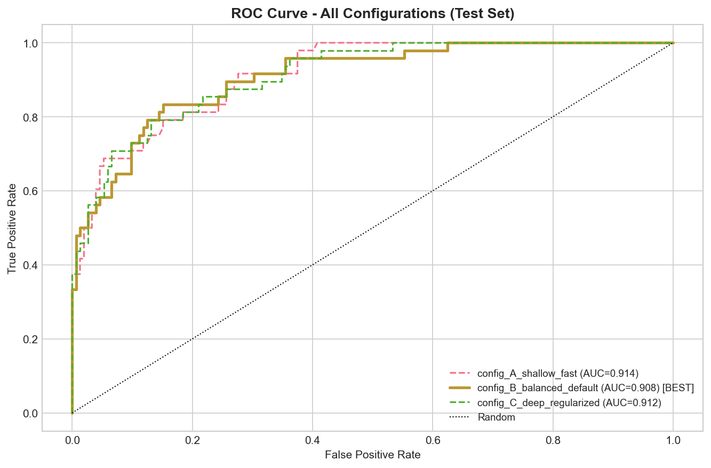

# Core model and experimentation report

**Experiment tracking:** MLflow, experiment `finwise_champion_model`, store `sqlite:///mlflow.db` (6 finished runs, all in `reports/mlflow_runs.csv`).
**Primary model:** XGBoost classifier. **Hyperparameter configurations compared:** 6.
**Best configuration:** `config_B_balanced_default`, MLflow run `7f13dccc15624bfd8acc28378e72b057`.
**Generated by:** `scripts/mlflow_report.py` straight from the MLflow database, so these numbers are the logged ones.

## 1. Result in one paragraph
Three XGBoost configurations were trained and logged to MLflow (parameters, train/validation/test metrics, best iteration, model).
The selection rule used is *highest validation Gini* (the test set plays no part in the choice). `config_B_balanced_default` won with validation Gini
**0.8750** and, on the untouched test set, reached **Gini 0.8169** (AUC 0.9084), which meets the project target of
0.45 or higher. The logistic-regression baseline scores 0.849 on the same test set, so the champion does **not** beat the baseline; both pass the target.

## 2. How to see the experiments
```bash
mlflow ui --backend-store-uri sqlite:///mlflow.db        # then open http://127.0.0.1:5000  and choose experiment "finwise_champion_model"
```
Screenshots: `docs/mlflow_ui_runs.png` (run list) and `docs/mlflow_ui_compare.png` (side-by-side comparison).


## 3. Configurations tested (logged parameters)
| Parameter | B_balanced_default | B_balanced_default | C_deep_regularized | C_deep_regularized | A_shallow_fast | A_shallow_fast |
|---|---|---|---|---|---|---|
| `n_estimators` | 500 | 500 | 800 | 800 | 300 | 300 |
| `max_depth` | 6 | 6 | 8 | 8 | 3 | 3 |
| `learning_rate` | 0.05 | 0.05 | 0.03 | 0.03 | 0.1 | 0.1 |
| `subsample` | 0.8 | 0.8 | 0.7 | 0.7 | 0.9 | 0.9 |
| `colsample_bytree` | 0.8 | 0.8 | 0.7 | 0.7 | 0.9 | 0.9 |
| `min_child_weight` | 5 | 5 | 8 | 8 | 3 | 3 |
| `gamma` | 0.1 | 0.1 | 0.2 | 0.2 | - | - |
| `reg_alpha` | 0.1 | 0.1 | 0.3 | 0.3 | 0 | 0 |
| `reg_lambda` | 1 | 1 | 2 | 2 | 1 | 1 |
| `scale_pos_weight` | 3.22 | 3.22 | 3.22 | 3.22 | 3.22 | 3.22 |

All three use early stopping (30 rounds on validation AUC) and `scale_pos_weight` for the class imbalance; `n_estimators` is a ceiling, and the trees actually used are shown below.

## 4. Results (logged metrics)
Split: 700 train / 100 validation / 200 test (stratified, seed 42).

| Config | Trees used | Val Gini | Val AUC | Test Gini | Test AUC | Test KS | Test Brier | Train-Val Gini gap |
|---|---|---|---|---|---|---|---|---|
| config_B_balanced_default **(selected)** | 16 | 0.8750 | 0.9375 | 0.8169 | 0.9084 | 0.6820 | 0.1376 | 0.0681 |
| config_B_balanced_default | 16 | 0.8750 | 0.9375 | 0.8169 | 0.9084 | 0.6820 | 0.1376 | 0.0681 |
| config_C_deep_regularized | 26 | 0.8728 | 0.9364 | 0.8232 | 0.9116 | 0.6601 | 0.1452 | 0.0299 |
| config_C_deep_regularized | 26 | 0.8728 | 0.9364 | 0.8232 | 0.9116 | 0.6601 | 0.1452 | 0.0299 |
| config_A_shallow_fast | 16 | 0.8717 | 0.9359 | 0.8274 | 0.9137 | 0.6404 | 0.1195 | 0.0341 |
| config_A_shallow_fast | 16 | 0.8717 | 0.9359 | 0.8274 | 0.9137 | 0.6404 | 0.1195 | 0.0341 |

Train-Val gap = train Gini minus validation Gini (overfitting signal). Figures: `experiment_roc_comparison.png`, `experiment_metric_comparison.png`.


## 5. Best configuration and the evidence for it
**Selected: `config_B_balanced_default`**

| Evidence | Value |
|---|---|
| Selection metric (validation Gini) | **0.8750**, highest of 6 runs (runner-up `config_B_balanced_default` 0.8750) |
| Final test Gini (held out from selection) | 0.8169 (target 0.45: **met**) |
| Test AUC / KS / Brier | 0.9084 / 0.6820 / 0.1376 |
| Early stopping | best iteration 15, 16 trees used |
| Baseline (logistic regression) test Gini | 0.8492 |

### Cross-validation check (supplementary, not part of the MLflow selection)
The validation set has only 100 rows, so I also ran 5-fold stratified cross-validation on train + validation (800 rows, test set untouched) using each run's logged hyperparameters (`scripts/cv_check.py`).

| Config | CV Gini (mean) | Std across folds | Trees |
|---|---|---|---|
| config_A_shallow_fast | 0.8254 | 0.0681 | 16 |
| config_A_shallow_fast | 0.8254 | 0.0681 | 16 |
| config_C_deep_regularized | 0.8182 | 0.0670 | 26 |
| config_C_deep_regularized | 0.8182 | 0.0670 | 26 |
| config_B_balanced_default | 0.8116 | 0.0719 | 16 |
| config_B_balanced_default | 0.8116 | 0.0719 | 16 |

The three configurations are within **0.014** Gini of each other, far smaller than the fold-to-fold standard deviation (about 0.069). **Conclusion: the configurations are statistically indistinguishable on this dataset.**

### Honest reading of the evidence
- The winning margin on validation is **0.0000 Gini on 100 rows, which is within noise**. `config_B_balanced_default` is the winner because it satisfies the selection rule (highest validation Gini),
  not because it is clearly better.
- On the test set the highest Gini belongs to `config_A_shallow_fast` (0.8274), not to the selected run. That is *expected* from noise with about 48 defaulters in the test set, and the test set was **deliberately not used to re-pick**:
  choosing a configuration after seeing test results would make the reported test score optimistic.
- The selected run's train-to-validation Gini gap is 0.068; the smallest gap (least overfitting) is `config_C_deep_regularized` at 0.030, a reasonable alternative if simplicity or overfitting matters more.
  Next step: a wider search (for example Optuna or random search with cross-validation) on more, real data.

## 6. Reproduce
```bash
python core_model_experimentation.py              # trains the 3 configs and logs them to MLflow (sqlite:///mlflow.db)
python scripts/cv_check.py                        # supplementary 5-fold CV
python scripts/mlflow_report.py                   # regenerates this report and reports/mlflow_runs.csv
mlflow ui --backend-store-uri sqlite:///mlflow.db
```
